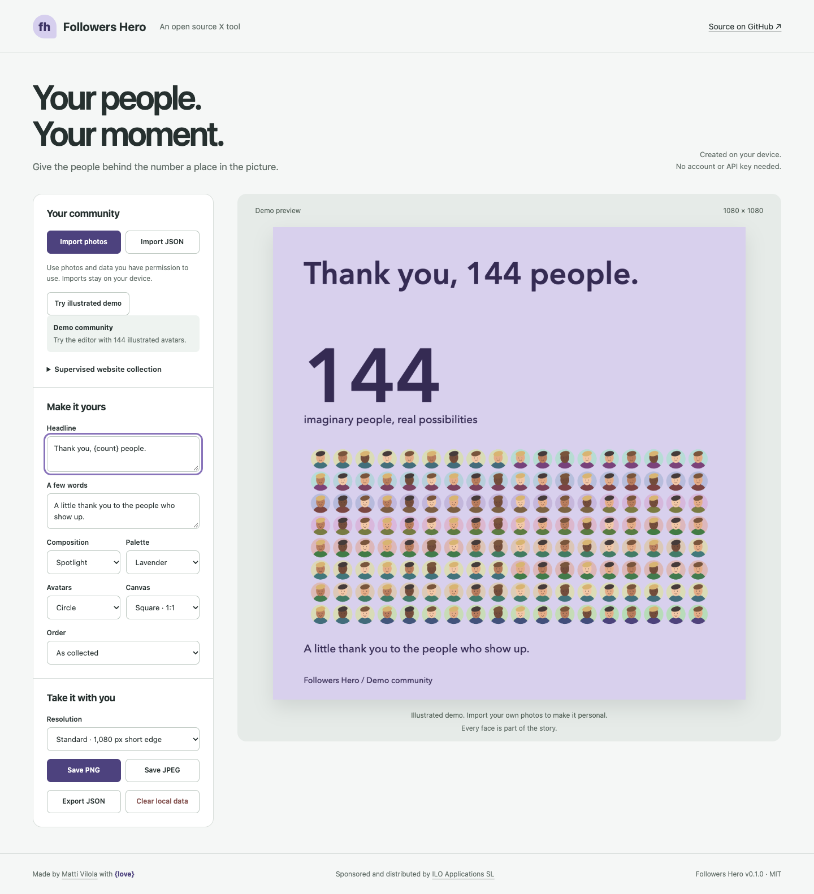

# X Tools

Open source tools for creating with your X (Twitter) community. Each tool lives in its own folder with its own README, setup and checks. More tools will be added as independent sibling projects.

**Made by [Matti Vilola](https://github.com/mattivilola) with ❤️, sponsored and distributed by [ILO Applications SL](https://iloapps.com).**

## Tools

| Tool | Purpose | Status |
| --- | --- | --- |
| [Followers Hero](./followers-hero-image/) | Turn community avatars into customizable celebration posters. Includes an offline editor and a supervised website collector with explicit risk acknowledgement. | Experimental v0.1.0 |
| [Followers Manager](./followers-manager/) | Track follower history, review relationships and run a continuously supervised unfollow selection with a live overlay. Written-authorized website use only. | Experimental v0.1.0 |
| [API Followers Management](./api-followers-management/) | Separate proposed API edition for follower tracking and permitted account management. | Feasibility research |
| API Followers Hero Image | A separate future tool using the official X API, subject to access, terms and export-rights review. | [Exploration plan](./docs/api-followers-hero-image-plan.md) |

### Followers Hero

Create a poster with three compositions, four palettes, multiple aspect ratios, a custom message and PNG/JPEG export. Try the illustrated demo, import your own photos or JSON, or use the supervised collection workflow after acknowledging X’s restrictions, the account risk and your responsibility.

**[Installation, supervision process and full tool documentation](./followers-hero-image/README.md)**



## X rules apply to every tool

Read [X access and usage decisions](./docs/x-platform-policy.md) before adding or using an integration. X prohibits non-API website automation and restricts scraping. A visible overlay, manual Start/Pause/Stop controls, slow scrolling or accepting responsibility does not override those restrictions. Followers Hero requires an explicit operator acknowledgement of those restrictions, account risk and continuous supervision. That acknowledgement does not grant or claim X permission, and there is no guarantee against account restrictions.

Automated regression tests use controlled local fixtures. Any separately requested live check is limited and supervised by the account owner; it does not establish permission under X’s rules.

## Repository layout

```text
x-tools/
├── followers-hero-image/   # First runnable extension
├── followers-manager/      # Local history and supervised following management
├── api-followers-management/ # Separate future API edition
├── docs/                  # Shared policy, research and future API plan
├── scripts/               # Packaging and optional browser verification
├── LICENSE
└── README.md
```

Use lowercase folder and file names with hyphens and no spaces. Each new tool must document installation, data handling, permissions, applicable X rules and validation.

## Development

Node.js 22 or newer; no runtime npm dependencies or extension build step.

```sh
npm test
npm run check
npm run package
```

Packaging writes a ZIP to `dist/`. Browser-check instructions are in the tool README.

## Contributing

Focused issues and pull requests are welcome. Read the [shared policy](./docs/x-platform-policy.md) first. Never commit personal follower exports, photos, account data, credentials or browser profiles. Describe your validation and any live-access requirements.

## License and credits

[MIT](./LICENSE) · Copyright 2026 Matti Vilola. Sponsored and distributed by ILO Applications SL.

Followers Hero is independently written and inspired by [XAvatarWall](https://github.com/qiujiu-dev/XAvatarWall). No upstream source or assets are included. See the [assessment](./docs/xavatarwall-assessment.md).

X and Twitter belong to their respective owners. This project is independent and is not affiliated with or endorsed by X. The source-code license does not grant rights to people’s photos or X content.
